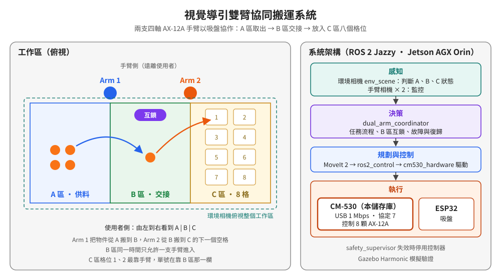
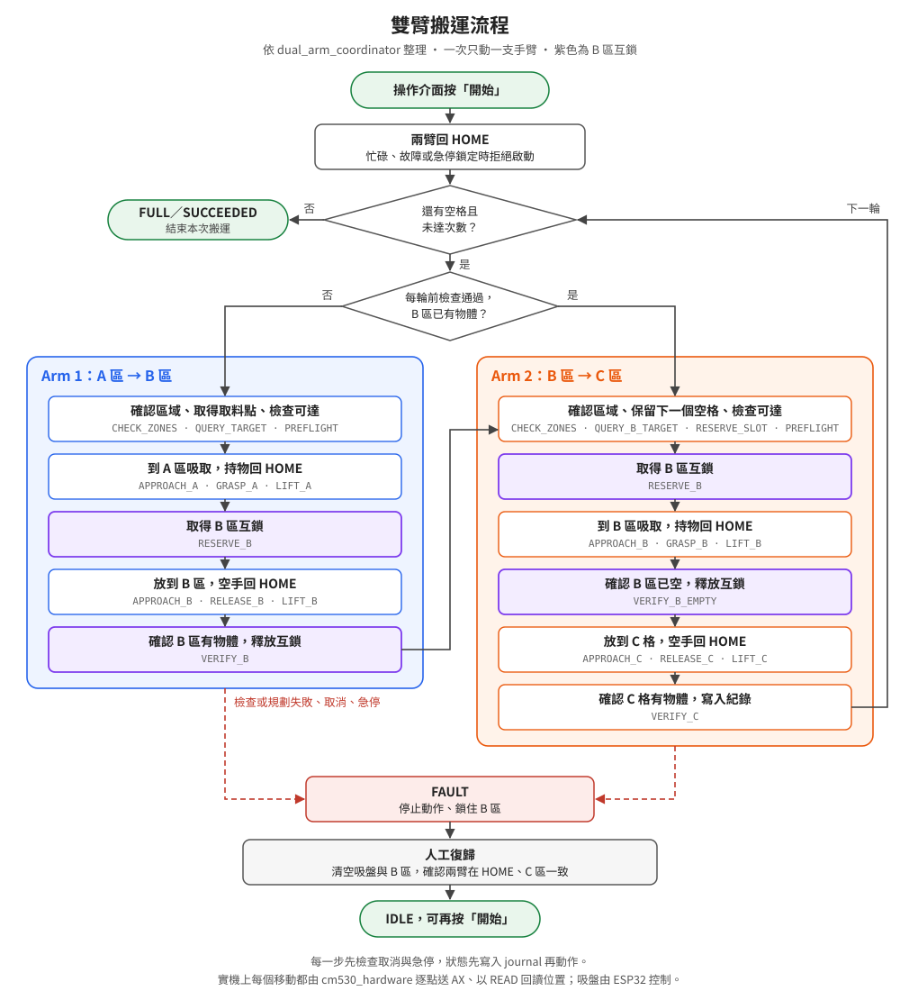
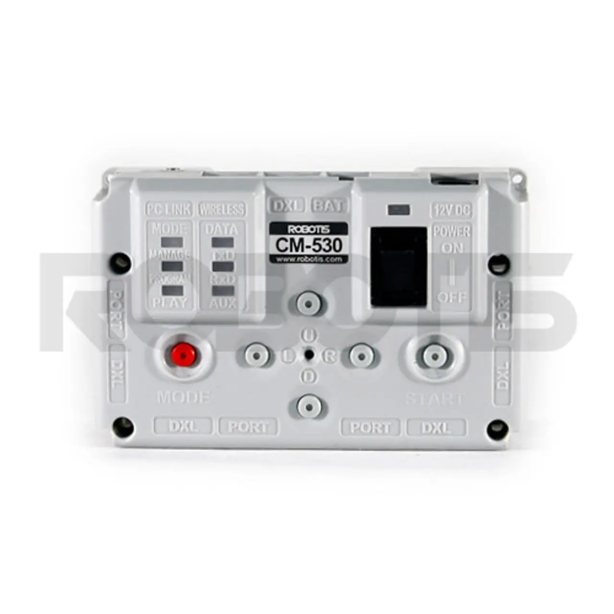
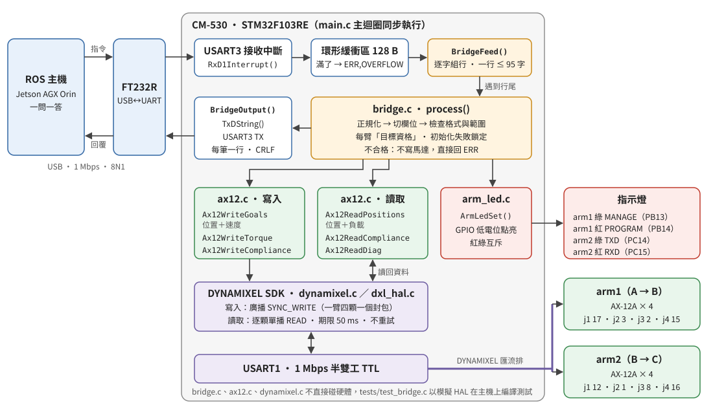

# CM530_ROS_BRIDGE｜CM-530 雙臂 AX-12A 橋接韌體

**目前版本：第 19 版｜主機序列協定：7｜主機連線：1 Mbps｜文件核對：2026-11-27**

這是 ROBOTIS CM-530 控制板的自製韌體，屬於「視覺導引雙臂協同搬運系統」。CM-530 位於 ROS 主機（NVIDIA Jetson AGX Orin）和兩支四軸 AX-12A 手臂之間：主機透過一條 USB 序列線送文字指令，CM-530 驗證指令後，經 DYNAMIXEL 匯流排寫入馬達目標、讀回位置與狀態，再回覆一行結果。

韌體只做三件事：**驗證指令、寫馬達、讀馬達**。路徑規劃、插值、到位判斷、軌跡排程、B 站互鎖、任務流程全部由 ROS 端負責。

> **狀態：** 第 19 版的建置與所有主機端（無板子）測試都已通過，**但尚未燒錄到板子，也尚未在實機驗收**。板子目前燒的是第 18 版（驗證紀錄尚未補上第 18 版的燒錄與實機結果）；第 18 版保留在原目錄，隨時可燒回。



---

## 目錄

1. [快速開始](#1-快速開始)
2. [版本重點：第 18 版與第 19 版](#2-版本重點第-18-版與第-19-版)
3. [系統分工](#3-系統分工)
4. [硬體與接線](#4-硬體與接線)
5. [通訊設定](#5-通訊設定)
6. [協定規則](#6-協定規則)
7. [指令一覽](#7-指令一覽)
8. [AX 指令與 Moving Speed](#8-ax-指令與-moving-speed)
9. [READ 與 Present Load](#9-read-與-present-load)
10. [COMP、GET_COMP 與 DIAG](#10-compget_comp-與-diag)
11. [扭力與「目標資格」](#11-扭力與目標資格)
12. [開機與握手流程](#12-開機與握手流程)
13. [錯誤碼](#13-錯誤碼)
14. [HOME 設定](#14-home-設定)
15. [建置、驗證與燒錄](#15-建置驗證與燒錄)
16. [測試](#16-測試)
17. [手動測試終端](#17-手動測試終端)
18. [韌體架構與目錄結構](#18-韌體架構與目錄結構)
19. [驗證狀態](#19-驗證狀態)
20. [版本歷史](#20-版本歷史)
21. [相關文件](#21-相關文件)

---

## 1. 快速開始

以下指令都在 `19 ROS to CM530 ver. dual arm/` 目錄下執行。主機端測試不需要板子。

```powershell
python -m pip install -r requirements.txt          # 安裝 pyserial
python manual_position_terminal.py --self-test      # Python 終端單元測試（27 項）
./tests/run_tests.ps1 -Python python -Compiler gcc  # Python ＋ 兩組 C 測試
```

> Windows 上若 `python` 只是 Microsoft Store 的捷徑而無法執行，改用 `py`；若沒有本機 gcc，可用 WSL 的 gcc（見[第 16 節](#16-測試)）或 `-Compiler <zig.exe> -CompilerArgs cc`。

連接實機（燒錄第 19 版之後）：

```powershell
python manual_position_terminal.py --port COM4 --arm arm1
```

---

## 2. 版本重點：第 18 版與第 19 版

### 第 18 版：AX 帶 Moving Speed、主機改 1 Mbps

第 17 版只寫入 AX-12A 的 Goal Position（位址 30），**從來不寫 Moving Speed（位址 32）**。Moving Speed 為 0 代表「不控制速度、用最高轉速移動」，而這個 RAM 暫存器開機後的值沒有保證。ROS 每個控制週期只送一小步，當 Moving Speed 是 0 時，馬達會全速走完這一小步、停下、再等下一筆，手臂因此一頓一頓地前進並前後擺動。

第 18 版的做法：

- Goal Position 與 Moving Speed 用**同一個 SYNC_WRITE** 寫入，馬達不會「用舊速度去追新目標」。
- `AX` 可再帶 4 個速度（1～1023）；不帶速度的 `AX` 以及 `HOME`、`HOLD` 一律用預設速度 **100**（約 67°/s）；速度 0 回 `ERR,RANGE`。
- 主機連線由 57600 提高到 **1 Mbps**：兩臂各一次「AX＋READ」的傳輸時間從約 28 ms 降到約 1.6 ms（以第 18 版的 READ 封包估算）。

### 第 19 版：讀負載、可調 compliance

2026-11-19 的晃動診斷懷疑：手臂離開 HOME 時齒輪換邊，加上出廠 compliance（slope 32）偏軟。第 18 版不能寫 compliance、也讀不到負載，所以沒辦法改參數比較，也看不到負載在哪裡換方向。第 19 版新增：

| 項目 | 第 18 版 | 第 19 版 |
|---|---|---|
| `READ` 回覆 | `POS,arm1,j1..j4` | `POS,arm1,j1..j4,l1..l4`（加上四個 Present Load） |
| `COMP` | — | 寫 Compliance Margin／Slope 與 Punch |
| `GET_COMP` | — | 從馬達讀回 margin、slope、punch |
| `DIAG` | — | 讀電壓（0.1 V）與溫度（°C） |
| 錯誤碼 | — | 新增 `DXL_ASYM`；`DXL_RANGE` 也涵蓋負載與 punch |
| 協定版本 | 6（`READY,6`、`VERSION,6`） | **7**（`READY,7`、`VERSION,7`） |
| Moving Speed、1 Mbps、HOME、指示燈 | — | 與第 18 版相同 |

開機時**不寫** compliance，沒送 `COMP` 時，馬達行為和第 18 版完全一樣。

**協定版本每一版都刻意不相容。** ROS 驅動只接受自己對應的 `VERSION`；板子版本不對，連線會直接失敗，不會在介面不一致的狀況下驅動手臂。

---

## 3. 系統分工

| 層級 | 負責內容 |
|---|---|
| ROS 主機（Jetson AGX Orin） | 相機與視覺辨識、任務協調、B 站互鎖、軌跡規劃與插值、計算每關節 Moving Speed、決定 compliance 設定並讀回比對、依 `READ` 判斷到位、異常處理 |
| CM-530（本韌體） | 解析並驗證文字指令、SYNC_WRITE 位置＋速度與 compliance、扭力開關、逐顆讀回位置／負載／compliance／電壓溫度、LED 顯示、回報錯誤 |
| AX-12A × 8 | 依 Goal Position、Moving Speed 與 compliance 設定移動 |

韌體沒有「任務」的觀念：沒有佇列、沒有插值、沒有完成事件，每一筆指令處理完就回覆一行。

### 搬運流程

下圖是 ROS 端任務協調節點 `dual_arm_coordinator` 實際執行的步驟（依 [dual_arm_system](https://github.com/xian1022/dual_arm_system) 整理）。圖中每個移動步驟，在實機上都由驅動逐點送 `AX`、以 `READ` 回讀位置；韌體只看得到這些指令，看不到狀態名稱。



---

## 4. 硬體與接線



| 項目 | 內容 |
|---|---|
| 控制板 | ROBOTIS CM-530，MCU 為 STM32F103RE（Cortex-M3，72 MHz） |
| 主機連線 | CM-530 的 PC Link（mini USB），板上 FT232R 轉 UART，接到 STM32 的 USART3（PB10／PB11） |
| 馬達匯流排 | STM32 的 USART1（重映射至 PB6／PB7），DYNAMIXEL Protocol 1.0，1 Mbps，半雙工 TTL |
| 馬達 | AX-12A × 8，關節模式（CW／CCW Angle Limit 都不是 0），Status Return Level 1 或 2 |
| 供電 | CM-530 建議 11.1 V；AX-12A 規格 9～12 V |

### 馬達 ID 對照

| 手臂 | 搬運區域 | j1（底座旋轉） | j2（肩） | j3（肘） | j4（腕） |
|---|---|---:|---:|---:|---:|
| arm1 | A → B | 17 | 3 | 2 | 15 |
| arm2 | B → C | 12 | 1 | 8 | 16 |

ID 寫死在 [APP/src/ax12.c](19%20ROS%20to%20CM530%20ver.%20dual%20arm/APP/src/ax12.c)。韌體不會修改馬達的 ID、EEPROM 或角度限位。它會寫入的 Moving Speed、Compliance、Punch 都是 RAM 暫存器，馬達斷電後回到出廠值。

### 指示燈

| 手臂 | 綠燈（MOVING） | 紅燈（STOPPED） |
|---|---|---|
| arm1 | MANAGE（PB13） | PROGRAM（PB14） |
| arm2 | TXD（PC14） | RXD（PC15） |

- LED 都是低電位點亮，切換時先全關再點亮，紅綠不會同時亮。AUX（PB12）、PLAY（PB15）保持熄滅。
- 開機時兩臂都亮紅燈。之後燈號只顯示 ROS 用 `LED` 指令設定的狀態，**韌體不會自己改燈，`STOPPED` 也不會讓馬達停下來**。

---

## 5. 通訊設定

| 連線 | 設定 |
|---|---|
| 主機 ↔ CM-530 | 1,000,000 baud、8 data bits、no parity、1 stop bit、無流量控制 |
| CM-530 ↔ AX-12A | 1,000,000 baud、DYNAMIXEL Protocol 1.0 |

### 為什麼 1 Mbps 可行

- STM32F103 的 USART3 掛在 36 MHz 的 APB1 上，1 Mbps 的除數是 36 MHz ÷ (16 × 1 Mbps) = **2.25**，可由小數分頻精確表示，**誤差 0%**。
- FT232R 在 TTL 電位下最高 3 Mbaud，1 Mbps = 3 MHz ÷ 3，**誤差 0%**。
- 主機與 STM32 之間是 FT232R 直接接 TTL，沒有 RS-232 轉換晶片，不受常見 RS-232 晶片 250 kbps 的限制。

ROBOTIS 沒有文件保證 CM-530 的 PC Link 能跑 1 Mbps，所以燒錄後要先用 `PING`／`VERSION` 確認。若現場通訊不穩，可退回 115200（兩端合計誤差約 0.3%，遠低於 3% 容許值）：同時修改 [main.c](19%20ROS%20to%20CM530%20ver.%20dual%20arm/APP/src/main.c) 的 `Baudrate_PC` 與主機端程式，並重新建置。

### USB latency timer（主機端要設定）

FT232R 預設的 latency timer 是 **16 ms**：收到的資料若沒填滿緩衝區，最多要等 16 ms 才交給電腦。CM-530 的回覆都很短，幾乎每次都等滿，一個控制週期最多會多出約 64 ms。ROBOTIS 建議高鮑率時改成 **1 ms**。

Linux（例如 Orin）：

```bash
echo 'ACTION=="add", SUBSYSTEM=="usb-serial", DRIVER=="ftdi_sio", ATTR{latency_timer}="1"' | sudo tee /etc/udev/rules.d/99-ftdi-latency.rules
sudo udevadm control --reload-rules
```

重新插拔後確認，應讀到 `1`：

```bash
cat /sys/bus/usb-serial/devices/ttyUSB0/latency_timer
```

Windows：裝置管理員 → 連接埠 → 該 COM 埠內容 → 連接埠設定 → 進階 → Latency Timer 設為 1。

---

## 6. 協定規則

- **格式：** ASCII 文字，大寫命令、小寫 `arm1`／`arm2`、半形逗號、十進位整數。例：`AX,arm1,512,512,512,512\n`
- **行尾：** 送出時 LF、CR、CRLF 都可以，建議用 LF；空行會被忽略。回覆一律以 CRLF 結尾。
- **長度：** 一行最多 95 個字元（緩衝 96 bytes），最多 16 個欄位。超過長度時回 `ERR,OVERFLOW`，並丟棄到下一個行尾為止。最長的合法指令是 `COMP,arm2,254,254,254,254,128,128,128,128,1023,1023,1023,1023`，61 字元、14 個欄位。
- **一問一答：** 整條連線同一時間只能有一筆待回覆的指令（包括兩支手臂和 LED）。一定要收完並核對上一筆回覆，才能送下一筆。`READ`、`GET_HOME`、`GET_COMP`、`DIAG` 成功時直接回一行資料，不會先回 `OK`。
- **沒有指令編號：** 韌體沒有序號、去重、佇列、取消或完成事件。**逾時後不可自動重送**，因為無法分辨遲到的回覆屬於哪一筆。
- **ACK 不等於生效：** `OK,AX,arm1`、`OK,COMP,arm1` 只代表封包已送上馬達匯流排。到位要由 ROS 用 `READ` 判斷；compliance 要用 `GET_COMP` 讀回確認。
- **兩臂共用連線：** 兩臂的指令可以交錯送，但同一瞬間只處理一筆，不保證兩臂同時起動。

### 韌體的輸入容錯（主機程式不應依賴）

| 輸入 | 韌體行為 |
|---|---|
| 命令與 arm 大小寫混用（`ax,ARM1,…`） | 接受 |
| 欄位前後的空白、Tab | 去除 |
| 整數前的 `+`／`-` 號 | 接受後再檢查範圍 |
| 行首 UTF-8 BOM、全形逗號 `，` | 去除 BOM、全形逗號視為半形 |
| Backspace（0x08）、DEL（0x7F） | 刪除前一個字元 |
| NUL（0x00） | 換成 `?`，使該欄位格式錯誤 |
| 浮點數、空欄位、多餘欄位、超過 32 位元的整數 | 拒絕（`ERR,BAD_ARG`） |

---

## 7. 指令一覽

以下 `arm1` 都可以換成 `arm2`。位置範圍 0～1023，**不代表機構能安全走完整個範圍**。

| 指令 | 成功回覆 | 作用 |
|---|---|---|
| `PING` | `PONG` | 確認通訊 |
| `VERSION` | `VERSION,7` | 確認協定版本 |
| `AX,arm1,p1,p2,p3,p4` | `OK,AX,arm1` | 寫入四軸目標，速度用預設 100 |
| `AX,arm1,p1,p2,p3,p4,s1,s2,s3,s4` | `OK,AX,arm1` | 寫入四軸目標和四個 Moving Speed（1～1023） |
| `HOME,arm1` | `OK,HOME,arm1` | 把板內 HOME 寫成目標，速度 100 |
| `GET_HOME,arm1` | `HOME,arm1,256,512,512,512` | 查詢板內 HOME，不動作 |
| `READ,arm1` | `POS,arm1,j1,j2,j3,j4,l1,l2,l3,l4` | 讀回四軸位置與負載（見第 9 節） |
| `HOLD,arm1` | `OK,HOLD,arm1` | 讀回四軸後，把目前位置寫成目標，速度 100 |
| `TORQUE,arm1,1` | `OK,TORQUE,arm1,1` | 上扭力；必須先有目標資格（見第 11 節） |
| `TORQUE,arm1,0` | `OK,TORQUE,arm1,0` | 卸扭力，並清除目標資格 |
| `COMP,arm1,m1..m4,s1..s4,p1..p4` | `OK,COMP,arm1` | 寫 margin、slope、punch（見第 10 節） |
| `GET_COMP,arm1` | `COMP,arm1,m1..m4,s1..s4,p1..p4` | 從馬達讀回 margin、slope、punch |
| `DIAG,arm1` | `DIAG,arm1,v1..v4,t1..t4` | 讀電壓（0.1 V）與溫度（°C） |
| `LED,arm1,MOVING` | `OK,LED,arm1,MOVING` | 綠燈亮、紅燈滅 |
| `LED,arm1,STOPPED` | `OK,LED,arm1,STOPPED` | 紅燈亮、綠燈滅 |

**注意事項：**

- `AX`、`HOME`、`HOLD` 不會自動上扭力；但扭力若已開著，寫入目標就會立刻動作。
- 每一筆 `AX` 都會直接送出，即使和上一筆完全相同。
- 所有讀取指令（`READ`、`HOLD`、`GET_COMP`、`DIAG`）都依 j1→j4 逐顆讀，任何一顆失敗就回錯誤，不回傳部分資料。每顆的接收期限 50 ms（`DXL_RX_TIMEOUT_MS`），不重試。
- `HOLD` 要四軸都讀成功才寫入目標；讀取失敗時不寫入部分目標。它有取樣和傳輸延遲，**不是急停**。
- `PING`、`VERSION` 帶任何參數，或其他指令缺少有效的 `arm1`／`arm2`，都回 `ERR,BAD_ARG`。
- 舊協定的 `BEGIN`、`PT`、`END`、`STOP` 已移除，送出會回 `ERR,BAD_CMD`。

---

## 8. AX 指令與 Moving Speed

### 單位

| 量 | 數值 |
|---|---|
| 位置 1 tick | 300° ÷ 1024 ≈ 0.29° |
| Moving Speed 1 單位 | 0.111 rpm ≈ 0.666°/s ≈ 2.27 tick/s |
| 最高轉速（12 V、無負載） | 59 rpm ≈ 354°/s，約等於 Moving Speed 531 |

超過約 531 的數值不會更快，因為馬達本身到不了；帶負載或電壓偏低時會更慢。

### 換算範例

| Moving Speed | rpm | °/s | rad/s |
|---:|---:|---:|---:|
| 20 | 2.2 | 13 | 0.23 |
| 50 | 5.6 | 33 | 0.58 |
| 100（預設） | 11.1 | 67 | 1.16 |
| 300 | 33.3 | 200 | 3.49 |

### 規則

- 速度範圍 **1～1023**。送 0 回 `ERR,RANGE`；不是整數或欄位數不是 6 或 10 個回 `ERR,BAD_ARG`。
- 檢查順序：先確認所有欄位都是整數，再逐軸檢查位置與速度範圍。任何一項不合格都**不寫馬達**，也不改變目標資格。
- 只帶 4 個位置時，四軸都用預設速度 100。
- `HOME`、`HOLD` **一律用預設速度 100**，不沿用上一筆 AX 的速度。這是為了避免上一筆設了很小的速度導致 HOME 走很久，也避免沿用開機後未知的速度。
- 預設速度定義在 [arm_config.h](19%20ROS%20to%20CM530%20ver.%20dual%20arm/APP/inc/arm_config.h) 的 `ARM_DEFAULT_SPEED`。

### 封包內容

韌體送出一個廣播 SYNC_WRITE：起始位址 30、每顆馬達 4 bytes，依序是 Goal Position 低位元組、高位元組、Moving Speed 低位元組、高位元組。一支手臂的四顆馬達共用這一個封包。

```
FF FF FE 18 83 1E 04  ID1 PL PH SL SH  ID2 …  ID3 …  ID4 …  CHK
```

### ROS 端怎麼算速度（參考）

主控端驅動（`cm530_hardware`，不在本儲存庫）每筆 AX 依關節計算速度：

```
速度 = max(1.2 × 指令角速度, 剩餘誤差 ÷ 0.25 秒)，換算成 Moving Speed 後限制在 20～300
```

指令角速度取自控制器連續兩筆位置指令的差。乘上 1.2 讓馬達稍快一點、不會越落越後；剩餘誤差那一項則讓軌跡結束後，最後幾個 tick 也能在約 0.25 秒內走完。

---

## 9. READ 與 Present Load

`READ` 對每顆馬達做一次單播讀取，從位址 36 讀 6 bytes（Present Position、Present Speed、Present Load），回覆只帶位置與負載：

```
READ,arm1
POS,arm1,417,403,402,415,117,1127,102,115
```

| 欄位 | 範圍 | 意思 |
|---|---|---|
| j1～j4 | 0～1023 | Present Position（原始位置值） |
| l1～l4 | 0～2047 | Present Load：0～1023 是大小（約 0.1% 最大扭力／單位）；**加 1024（bit 10）代表 CW 方向** |

- 上例的 1127 = 1024 + 103，表示 j2 往 CW 方向出力約 103。
- 負載是馬達自己的估計值，沒有經過扭力量測校正，適合用來看「何時換方向、相對大小」，不適合當絕對扭力。
- 讀取次數和第 18 版一樣（每臂四次），每顆只多 4 bytes。四顆是依序取樣，沒有板端時間戳。
- 位置不在 0～1023 或負載不在 0～2047 回 `ERR,DXL_RANGE,<arm>,<id>`。
- `HOLD` 走同一個讀取流程，所以負載異常也會讓 `HOLD` 失敗。

---

## 10. COMP、GET_COMP 與 DIAG

### 參數意義

| 參數 | 位址 | 允許值 | 出廠值 | 效果 |
|---|---|---|---|---|
| Compliance Margin | 26（CW）、27（CCW） | 0～254 | 1 | 目標附近的不出力死區 |
| Compliance Slope | 28（CW）、29（CCW） | 2、4、8、16、32、64、128 | 32 | **越小越硬**：接近目標時出力越大 |
| Punch | 48～49 | 32～1023 | 32 | 最小出力；太大容易抖動、發熱 |

這些都是 RAM 暫存器：**馬達斷電後回到出廠值**；只重啟控制板不會改變它們。韌體開機時不寫入，由主機在每次啟用時寫入並讀回確認。

### COMP：寫入

```
COMP,arm1,1,1,1,1,32,16,16,32,32,32,32,32
OK,COMP,arm1
```

欄位順序是 4 個 margin、4 個 slope、4 個 punch（各依 j1～j4）。

- 每顆的 CW、CCW 寫成同一值。先以 SYNC_WRITE 寫位址 26～29（margin、margin、slope、slope），再以 SYNC_WRITE 寫位址 48～49（punch）。
- 任一值格式或範圍錯誤時整筆拒絕（`BAD_ARG`／`RANGE`），**不送任何封包**。
- 任一筆 SYNC_WRITE 傳送失敗回 `ERR,DXL_TX`。第一筆成功、第二筆失敗時，margin／slope 已改、punch 沒改。
- `OK,COMP` 只代表兩筆封包送出，**一定要用 `GET_COMP` 讀回比對**。
- 不改目標、不改扭力、不改目標資格；扭力開或關都可以送。

### GET_COMP：讀回

```
GET_COMP,arm1
COMP,arm1,1,1,1,1,32,16,16,32,32,32,32,32
```

- 回覆標籤是 `COMP`（不是 `GET_COMP`），格式與 `COMP` 指令的參數相同。
- 每顆從位址 26 讀 24 bytes，取 margin（26、27）、slope（28、29）、punch（48、49）。
- 某顆的 CW 與 CCW margin 或 slope 不同時，回 `ERR,DXL_ASYM,<arm>,<id>`。`COMP` 一律寫成相同值，所以這代表有別的程式改過，或寫入只完成一半；應拒絕啟用並重新送 `COMP`。
- punch 超過 1023 回 `ERR,DXL_RANGE,<arm>,<id>`。

### DIAG：電壓與溫度

```
DIAG,arm1
DIAG,arm1,121,120,121,119,34,38,36,33
```

- 前 4 個是 Present Voltage（單位 0.1 V，121 = 12.1 V），後 4 個是 Present Temperature（°C）。每顆讀位址 42～43。
- 只讀取，不改任何狀態。建議低頻率使用（啟用時、調整 compliance 之後），不要放進 100 Hz 控制迴圈。

### 建議的使用流程

1. 有設定檔時，在上扭力**之前**送 `COMP`。
2. `GET_COMP` 讀回，與送出的值逐一比對；不一致就不要啟用。
3. 一次只改一個參數做比較，並用 `DIAG` 觀察溫度。

---

## 11. 扭力與「目標資格」

「目標資格」是韌體內部的旗標，每支手臂各一個，決定能不能上扭力。它**不代表**已經上扭力、已經到位，或馬達確實收到目標。

| 事件 | 該臂的目標資格 | 對馬達的影響 |
|---|---|---|
| 開機 | 清除 | 嘗試卸扭力 |
| `AX`／`HOME` 成功 | 建立 | 寫入目標和速度 |
| `AX`／`HOME` 傳送失敗 | 清除 | 結果未知 |
| `HOLD` 成功 | 建立 | 讀四軸後寫入目標 |
| `HOLD` 讀取或寫入失敗 | 清除 | 讀取失敗時不寫入；寫入失敗時結果未知 |
| `TORQUE,0`（不論傳送成敗） | 清除 | 嘗試卸扭力 |
| `TORQUE,1` | 不變 | 有資格才嘗試上扭力，沒有就回 `ERR,NO_TARGET` |
| `COMP`（不論傳送成敗） | 不變 | 寫 compliance 與 punch，不寫目標 |
| `READ`、`GET_COMP`、`DIAG`、`GET_HOME`、`PING`、`VERSION`、`LED` | 不變 | 只讀取，或只更新燈號 |
| 格式或範圍錯誤 | 不變 | 不寫馬達 |

**正常上扭力順序：**（需要時先 `COMP` → `GET_COMP` 比對）→ 設定完整目標（`AX`、`HOME` 或 `HOLD`）→ 確認 `OK` → `TORQUE,arm1,1` → 確認 `OK`。任何一次卸扭力之後，都要重新設定目標才能再上扭力。兩支手臂的資格各自獨立，一臂失敗不影響另一臂。

---

## 12. 開機與握手流程

### 控制板開機

1. 初始化時脈、GPIO、LED、SysTick、計時器、DYNAMIXEL 與主機兩個 UART。
2. 兩臂亮紅燈，清除兩臂目標資格。
3. 對兩支手臂各送一次卸扭力（第一臂失敗也一定會試第二臂）。不發位置、不執行 HOME、不寫 compliance。
4. 兩筆都傳送成功 → 輸出 `READY,7`；任何一筆失敗 → 輸出 `ERR,INIT_FAILED`。

`READY,7` 只代表封包送出，不證明馬達真的卸力。初始化失敗後，`AX`、`TORQUE`、`HOME`、`READ`、`HOLD`、`COMP`、`GET_COMP`、`DIAG` 都回 `ERR,INIT_FAILED,<arm>`，直到重新開機；`PING`、`VERSION`、`LED`、`GET_HOME` 仍可使用。

### 主機開埠握手

1. 開啟序列埠（1 Mbps、8N1）。`READY,7` 只在開機那一刻送出，開埠時可能已經錯過，沒收到不算失敗。
2. 建議先送一串 DEL（0x7F），清掉韌體緩衝區裡上一次留下的半行。DEL 只刪字，不會像換行一樣把殘留內容當成指令執行。
3. `VERSION` → 必須回 `VERSION,7`。回 `VERSION,6` 表示板子還是第 18 版，應停止。
4. `PING` → `PONG`。
5. 依需要 `GET_HOME`、`READ`、`DIAG`，有設定檔時 `COMP`＋`GET_COMP`，確認姿勢後再設定目標、上扭力。

主機在一筆指令進行中收到 `READY` 開頭的行，代表控制板重新開機，所有狀態（扭力、目標資格、LED）都要重新確認。Compliance 若馬達也斷過電，也要重新寫入。

---

## 13. 錯誤碼

格式：`ERR,<代碼>[,<arm>][,<馬達 ID>][,<錯誤位元>]`。能辨識出手臂時才帶 arm；讀取類錯誤（來自 `READ`、`HOLD`、`GET_COMP`、`DIAG`）會帶出錯的馬達 ID。

| 代碼 | 意思 | 處理方式 |
|---|---|---|
| `BAD_CMD` | 不支援的指令（例如 `STOP`） | 修正指令，不要重試 |
| `BAD_ARG` | 欄位數、arm、整數格式、扭力值或 LED 狀態不合法 | 修正指令 |
| `RANGE` | 位置、速度、margin、slope、punch 超出允許值，或板內 HOME 超出範圍 | 修正數值 |
| `NO_TARGET` | 還沒有目標資格就要上扭力 | 先處理之前的失敗，再設定目標 |
| `INIT_FAILED` | 開機初始化失敗，馬達指令被鎖住 | 重新開機 |
| `OVERFLOW` | 一行太長，或主機接收環形緩衝區滿了 | 停止排程，重新同步連線 |
| `DXL_TX` | 送往馬達的封包傳送失敗；帶 ID 時是讀取請求失敗 | 不能證明馬達沒動；不自動重送 |
| `DXL_TIMEOUT` | 讀某顆馬達時 50 ms 內完全沒有回應 | 檢查 ID、供電、線材 |
| `DXL_CORRUPT` | 回應的 ID、長度或 checksum 不符，或只收到一部分 | 檢查線材、雜訊 |
| `DXL_RX` | 其他接收失敗 | 檢查硬體 |
| `DXL_MOTOR` | 馬達回報錯誤位元 | 依位元判斷（見下） |
| `DXL_RANGE` | 讀回的位置不在 0～1023、負載不在 0～2047，或 punch 超過 1023 | 不要當成有效資料 |
| `DXL_ASYM` | `GET_COMP`：某顆的 CW 與 CCW margin／slope 不同 | 重新送 `COMP`，讀回一致前不要啟用 |

單顆讀取的檢查順序：傳輸 → 馬達錯誤位元 → 回覆長度 → 數值範圍（`GET_COMP` 先檢查 CW／CCW 一致，再檢查 punch）。

`DXL_MOTOR` 的錯誤位元（十進位，可相加）：1 電壓、2 角度限制、4 過熱、8 範圍、16 checksum、32 過載、64 指令。例如 `ERR,DXL_MOTOR,arm1,3,36` = arm1 的 ID 3 回報過熱＋過載。

---

## 14. HOME 設定

HOME 寫在 [APP/inc/arm_config.h](19%20ROS%20to%20CM530%20ver.%20dual%20arm/APP/inc/arm_config.h)：

```c
static const unsigned short home_A[4] = {256, 512, 512, 512};  /* arm1 */
static const unsigned short home_C[4] = {256, 512, 512, 512};  /* arm2 */
#define ARM_DEFAULT_SPEED 100
```

- 這是馬達的原始位置值（j1～j4），不是角度。數值於 2026-11-13 改定，並以當天板子 `GET_HOME` 的回覆確認過；第 19 版沒有變更。
- `HOME` 只是一組預設目標，不是感測器歸零，也不保證回程路徑不碰撞。手臂離 HOME 很遠時，由 ROS 規劃避障路徑，用 `AX` 逐點送比較安全。
- 修改 HOME 後要重新建置、驗證、更新 `SHA256SUMS` 並燒錄。Makefile 已設定 `arm_config.h` 變動時重新編譯 `bridge.o`。
- ROS 端的校正檔（`expected_home`）要與這裡一致，否則驅動會拒絕連線。
- 量測流程見 [HOME 校正資料收集](19%20ROS%20to%20CM530%20ver.%20dual%20arm/HOME_CALIBRATION_TEST.md)。

---

## 15. 建置、驗證與燒錄

在 `19 ROS to CM530 ver. dual arm/` 目錄下執行。

### 需要的工具

| 工具 | 用途 | 已驗證的版本 |
|---|---|---|
| Arm GNU Toolchain（`arm-none-eabi-gcc`） | 編譯韌體 | 14.2 rel1 |
| make | 建置 | WinARM 內附 |
| gcc（主機端） | C 單元測試 | WSL Ubuntu 24.04 的 gcc 13.3 |
| Python 3 ＋ pyserial ≥ 3.5 | 手動終端、驗證腳本 | — |

### 建置

```powershell
make -B TCHAIN_PREFIX=arm-none-eabi- "COMPILE_OPTS=-mcpu=cortex-m3 -mthumb -Wall -g -Os -fno-common -fno-strict-aliasing -Wno-error=implicit-function-declaration -Wno-error=incompatible-pointer-types -Wno-error=int-conversion" CM530.hex CM530.bin
```

Makefile 預設的 `TCHAIN_PREFIX` 是舊的 `arm-eabi-`，必須如上覆寫。建置會出現來自原廠 SDK（`dxl_hal.c` 的隱式宣告、`stm32f10x_vector.c`）的既有警告，不影響功能。

### 驗證產物

```powershell
python tests/verify_firmware.py
```

檢查 ELF 是 ARM 格式、HEX checksum、HEX 和 BIN 內容一致、向量表（堆疊 0x20010000、Reset 位於 Flash 內）、馬達 ID 對照，以及協定 7 的字串（含 `COMP`、`GET_COMP`、`DIAG`、`DXL_ASYM`）都在、舊協定（2～6、BEGIN／PT／END）的字串都不在。通過後更新 [SHA256SUMS](19%20ROS%20to%20CM530%20ver.%20dual%20arm/SHA256SUMS)。

> `CM530.elf` 被 `.gitignore` 排除、沒有進版控，所以**剛 clone 下來時要先建置一次**才能執行這支腳本；`SHA256SUMS` 中的 ELF 雜湊是建置當時的本機紀錄。

目前第 19 版的燒錄檔（2026-11-27 重新計算，與 `SHA256SUMS` 一致）：

| 檔案 | 大小 | SHA-256 |
|---|---:|---|
| CM530.hex | 39,042 bytes | `2aa97dc92c36479659e788ed591109a9f70d353af30dbee993bfaedeb4aa9d28` |
| CM530.bin | 13,860 bytes | `7a9c5a975300e7dfa7b5460d0e695269c6b62d32cef3b9ec0440d6b09d1651fe` |

### 燒錄

> 燒錄與驅動馬達需要明確授權後才進行；ACK 不證明實際到位。

- 燒錄檔：[CM530.hex](19%20ROS%20to%20CM530%20ver.%20dual%20arm/CM530.hex) 或 [CM530.bin](19%20ROS%20to%20CM530%20ver.%20dual%20arm/CM530.bin)
- Flash 起點：**0x08003000**（前面是 CM-530 原廠 bootloader，不可覆蓋；向量表也設在此位移）
- 使用既有的 CM-530 bootloader 流程（例如 RoboPlus Terminal）燒錄；燒錄後關閉 RoboPlus，避免占用序列埠。

燒錄後確認：

1. 開機兩臂亮紅燈。
2. 以 1 Mbps 開埠，`VERSION` → `VERSION,7`，`PING` → `PONG`。
3. `GET_HOME,arm1`、`GET_HOME,arm2` 都回 `256,512,512,512`。
4. `READ` 回 10 個欄位；`DIAG` 的電壓、溫度合理。
5. `GET_COMP` 讀到出廠值（margin 1、slope 32、punch 32），`COMP` 後再 `GET_COMP` 讀回相同的值。
6. 連續送約 1000 次 `PING`，確認 1 Mbps 沒有通訊錯誤。

要回到第 18 版時，燒錄 `18 ROS to CM530 ver. dual arm/CM530.hex`，主機端也要換回協定 6 的程式。

---

## 16. 測試

主機端測試不需要板子：以模擬的 HAL 與 GPIO，直接編譯正式的 `bridge.c`、`ax12.c`、`dynamixel.c`、`arm_led.c` 來測，並以 `-std=gnu89 -Wall -Wextra -Werror` 編譯。

### Windows（PowerShell）

```powershell
python -m pip install -r requirements.txt
python manual_position_terminal.py --self-test
./tests/run_tests.ps1 -Python python -Compiler gcc
```

`run_tests.ps1` 依序執行 Python 測試、`test_bridge`、`test_arm_led`，任何一步失敗就停止。

### Linux 或 WSL

```bash
gcc -std=gnu89 -Wall -Wextra -Werror -IAPP/inc APP/src/bridge.c APP/src/ax12.c APP/src/dynamixel.c tests/test_bridge.c -o /tmp/test_bridge && /tmp/test_bridge
gcc -std=gnu89 -Wall -Wextra -Werror -Itests/fakes -IAPP/inc APP/src/arm_led.c tests/test_arm_led.c -o /tmp/test_arm_led && /tmp/test_arm_led
```

- 加上 `-fsanitize=address,undefined -fno-omit-frame-pointer -g` 可同時檢查記憶體與未定義行為。
- `test_bridge` 可帶一個群組名稱只跑該組，例如 `/tmp/test_bridge comp`。

### 測試涵蓋範圍

| 測試 | 內容 |
|---|---|
| `test_bridge.c` `boot` | 開機卸扭力、`READY,7`、目標資格、初始化失敗鎖定 |
| `test_bridge.c` `direct` | AX 直接寫入、已移除的舊指令、傳送失敗時清除資格 |
| `test_bridge.c` `sdk` | DYNAMIXEL SDK 接收：逾時、ID 錯、長度錯、checksum 錯、截斷 |
| `test_bridge.c` `led` | LED 指令、兩臂隔離、初始化失敗時 LED 仍可用 |
| `test_bridge.c` `input` | 格式錯誤、溢位、BOM、全形逗號、NUL、過長的行 |
| `test_bridge.c` `v17` | HOME、GET_HOME、READ、HOLD 和各種讀取錯誤 |
| `test_bridge.c` `speed` | 四個速度的封包內容、速度 0／1024／負數、欄位數錯誤、HOME／HOLD 一律用預設速度 |
| `test_bridge.c` `comp` | **第 19 版新增：** COMP 封包內容與各參數邊界、欄位數錯誤、兩筆 SYNC_WRITE 各自失敗、COMP 不影響目標資格、GET_COMP 的逾時／ASYM／punch 範圍／馬達錯誤、DIAG、READ 負載與 CW 位元、負載範圍、回覆過短、初始化失敗鎖定、最長合法指令 |
| `test_arm_led.c` | LED 腳位、低電位點亮、紅綠互斥、時脈啟用、不碰電源與 UART 腳位 |
| `tests/test_terminal.py` | 手動終端的指令解析、回覆核對、握手（27 項） |
| `tests/verify_firmware.py` | 燒錄產物的完整性 |

測試結果、失敗與待辦一律記錄在 [驗證與測試總整理](驗證與測試總整理.md)，並區分本次重跑與歷史紀錄、實機觀察與模擬。

---

## 17. 手動測試終端

[manual_position_terminal.py](19%20ROS%20to%20CM530%20ver.%20dual%20arm/manual_position_terminal.py) 是現場用的序列終端，預設 1 Mbps、協定 7。ROS 驅動、RoboPlus 與終端不能同時開同一個序列埠。

```powershell
python manual_position_terminal.py --port COM4 --arm arm1
```

```bash
python3 manual_position_terminal.py --port /dev/serial/by-id/<控制板> --arm arm1
```

### 參數

| 參數 | 預設 | 說明 |
|---|---|---|
| `--port` | `COM4` | 序列埠 |
| `--baud` | `1000000` | 鮑率 |
| `--arm` | 無 | `arm1` 或 `arm2`；指定後可用四個數字當 AX 簡寫，`demo` 只動這一臂 |
| `--timeout` | `2.0` | 每筆回覆的等待秒數 |
| `--startup-listen` | `6.0` | 開埠後等待 `READY,7` 的秒數（沒收到不算失敗） |
| `--line-end` | `lf` | `lf`、`cr` 或 `crlf` |
| `--char-delay` | `0` | 逐字送出時每字元的間隔秒數 |
| `--self-test` | — | 只執行單元測試，不開埠 |

### 使用方式

- 開埠後自動送 `VERSION`（必須回 `VERSION,7`）與 `PING`。
- 輸入 `?` 看指令，`q` 離開。
- 指定 `--arm` 時，可直接輸入四個數字（逗號或空白分隔）當作 `AX`。
- 送出前會在本機檢查：位置 0～1023、速度 1～1023、扭力 0／1、margin 0～254、slope 為 2～128 的 2 的次方、punch 32～1023、欄位數、行長度；不合格只顯示 `LOCAL ERR`，不送出。
- 每筆回覆都要完全符合預期（`READ`、`GET_COMP`、`DIAG` 會檢查欄位數與每組數值範圍）；收到錯誤、逾時、未預期的資料或 `READY`（代表控制板重開），終端立刻停止，不再送任何動作指令。
- `demo` 會把目標設為 512 並上扭力，再讓 j1 在 512 → 520 → 512 之間移動；沒有 `--arm` 時兩臂交替。這不是 HOME 流程，使用前要確認這些位置對機構安全。**結束時不會卸扭力，也不改 LED。**

---

## 18. 韌體架構與目錄結構

### 資料流



- 接收中斷只負責放進環形緩衝區；緩衝區滿時設溢位旗標並丟棄到下一個行尾，主迴圈據此回 `ERR,OVERFLOW`。
- 指令在主迴圈中同步執行（包括 DYNAMIXEL 傳輸），因為主機必須等回覆才送下一筆，緩衝區不會被灌爆。
- `bridge.c` 不依賴硬體，透過 `BridgeOutput()`、`BridgeSetArmLed()` 與平台溝通，所以能在主機上直接測試。
- `ax12.c` 的讀取函式在四顆全部成功後才寫入輸出陣列；失敗時呼叫端拿到的仍是舊內容，不會混入部分資料。

### 目錄結構

```
CM530_ROS_BRIDGE/
├── 19 ROS to CM530 ver. dual arm/      ← 目前版本（協定 7：負載、compliance、診斷）
│   ├── APP/
│   │   ├── inc/arm_config.h            HOME 與預設速度
│   │   ├── src/main.c                  時脈、UART（含主機鮑率）、中斷接收、主迴圈
│   │   ├── src/bridge.c                指令解析、目標資格、回覆
│   │   ├── src/ax12.c                  ID 對照、SYNC_WRITE（位置＋速度、compliance、punch）、
│   │   │                               扭力、讀位置／負載／compliance／電壓溫度
│   │   ├── src/arm_led.c               兩臂指示燈
│   │   ├── src/dynamixel.c, dxl_hal.c  ROBOTIS DYNAMIXEL SDK（已加強接收檢查）
│   │   └── src/stm32f10x_it.c          中斷向量
│   ├── stm32f10x_lib/                  ST 原廠函式庫
│   ├── tests/                          主機端測試（C harness、fake GPIO、Python、產物驗證）
│   ├── manual_position_terminal.py     手動終端
│   ├── ROS_CM530_INTERFACE_SPEC.md     完整對接規格
│   ├── HOME_CALIBRATION_TEST.md        HOME 量測流程
│   ├── Makefile, stm32.ld              建置設定（Flash 起點 0x08003000）
│   └── CM530.hex, CM530.bin, SHA256SUMS
├── 18 ROS to CM530 ver. dual arm/      ← 上一版（協定 6），板子目前燒的版本，保留不動
├── 17 ROS to CM530 ver. dual arm/      ← 協定 5、57600，保留不動
├── 12～16 …                            更早的橋接版本
├── 01～11 …                            ROBOTIS 原廠功能範例
├── embeddec_c(cm530_v1_02) of/         ROBOTIS Embedded C 原始範例
├── docs/images/                        系統示意圖、搬運流程圖、韌體架構圖、控制板照片
├── 驗證與測試總整理.md                  所有版本的測試與驗收紀錄
└── AGENTS.md                           開發規範
```

`01`～`18` 目錄保留作為範例與歷史實作，除非明確需要，不要修改。

---

## 19. 驗證狀態

| 項目 | 狀態 | 日期 |
|---|---|---|
| 第 19 版 ARM 完整建置、`verify_firmware.py` | 通過 | 2026-11-20 |
| 第 19 版 C 測試（含 COMP／GET_COMP／DIAG／負載），gcc 13、`-Werror` | 通過 | 2026-11-20；2026-11-27 重跑通過 |
| 同上，加 AddressSanitizer ＋ UBSan | 通過 | 2026-11-20 |
| 變異測試：放寬 punch 下限、移除 CCW slope 比對 | 兩項都被 `comp` 測試抓到 | 2026-11-20 |
| 第 19 版 Python 終端測試 27 項 | 通過 | 2026-11-20；2026-11-27 重跑通過 |
| HEX／BIN 雜湊與 `SHA256SUMS` 一致 | 符合 | 2026-11-27 |
| ROS 驅動透過模擬序列埠跑第 19 版解析器（端對端，含 COMP 寫入與讀回） | 通過 | 2026-11-20 |
| **燒錄第 19 版** | 尚未執行 | — |
| **COMP 寫入與讀回、負載、DIAG 實機驗收** | 尚未執行 | — |
| **調整 compliance 後的晃動比較** | 尚未執行 | — |
| 第 18 版：1 Mbps 實機連線、速度控制實機效果 | 尚未記錄 | — |
| HOME 實機姿態 | 尚未驗收 | — |

以上「通過」全部是主機端模擬或檔案檢查，沒有任何一項是實機觀察。完整紀錄見 [驗證與測試總整理](驗證與測試總整理.md)。

---

## 20. 版本歷史

| 版本 | 協定 | 主機鮑率 | 重點 |
|---|---|---|---|
| **19**（2026-11-20） | 7 | 1 Mbps | READ 帶 Present Load；新增 COMP／GET_COMP／DIAG 與 `DXL_ASYM`；開機不寫 compliance |
| 18（2026-11-18） | 6 | 1 Mbps | AX 帶 Moving Speed；HOME／HOLD 用預設速度 100；拒絕速度 0 |
| 17（2026-10-07，HOME 於 2026-11-13 改為 256,512,512,512） | 5 | 57600 | 新增 HOME、GET_HOME、READ、HOLD；移除 BEGIN／PT／END／STOP；只寫位置 |
| 16（2026-09-30） | 4 | — | 雙臂 AX、TORQUE、LED |
| 12～15 | — | — | 早期橋接版本，指令語法（例如 BEGIN／PT／END）與現行不相容 |
| 01～11 | — | — | ROBOTIS 原廠功能範例（LED、按鈕、序列埠、DYNAMIXEL 讀寫等） |

---

## 21. 相關文件

| 文件 | 內容 |
|---|---|
| [第 19 版操作說明](19%20ROS%20to%20CM530%20ver.%20dual%20arm/README.md) | 版本目錄內的簡要說明 |
| [ROS ↔ CM-530 對接規格](19%20ROS%20to%20CM530%20ver.%20dual%20arm/ROS_CM530_INTERFACE_SPEC.md) | 完整協定、收發範例、錯誤處理建議 |
| [第 18 版操作說明](18%20ROS%20to%20CM530%20ver.%20dual%20arm/README.md) | 上一版 |
| [驗證與測試總整理](驗證與測試總整理.md) | 所有版本的測試與驗收紀錄 |
| [HOME 校正資料收集](19%20ROS%20to%20CM530%20ver.%20dual%20arm/HOME_CALIBRATION_TEST.md) | HOME 量測流程 |
| [搬運流程圖](docs/images/transport-flow.svg) | `dual_arm_coordinator` 的任務流程、B 區互鎖與人工復歸 |
| [dual_arm_system](https://github.com/xian1022/dual_arm_system) | ROS 2 雙臂系統主專案（任務協調、視覺、MoveIt、`cm530_hardware` 驅動） |
| [AGENTS.md](AGENTS.md) | 開發規範 |
| [ROBOTIS CM-530 e-Manual](https://emanual.robotis.com/docs/en/parts/controller/cm-530/) | 控制板官方說明 |
| [ROBOTIS AX-12A e-Manual](https://emanual.robotis.com/docs/en/dxl/ax/ax-12a/) | 馬達控制表（Goal Position、Moving Speed、Compliance、Present Load 等） |
